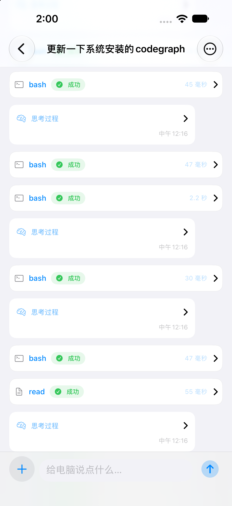
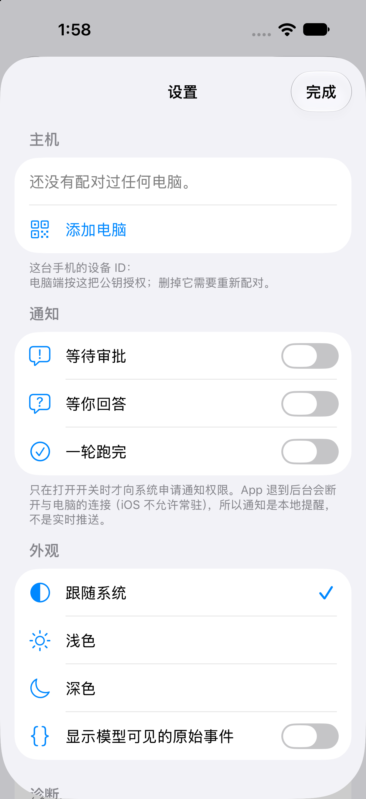
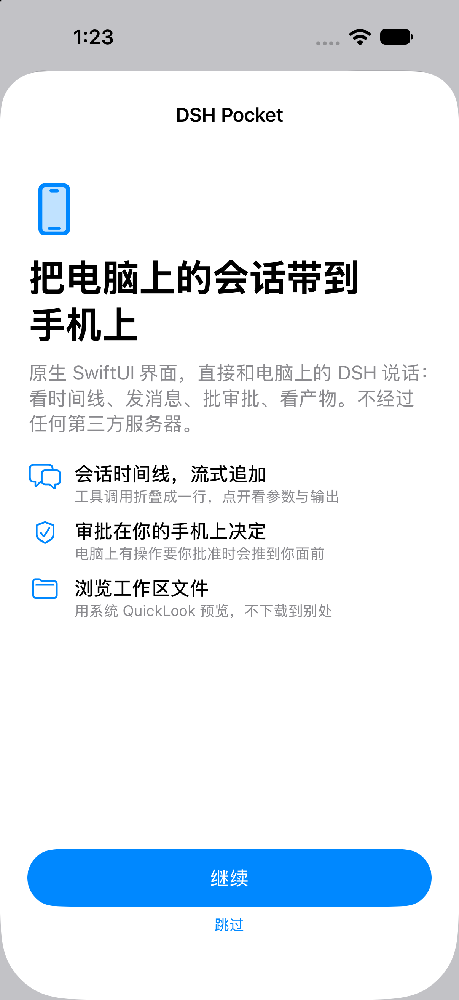
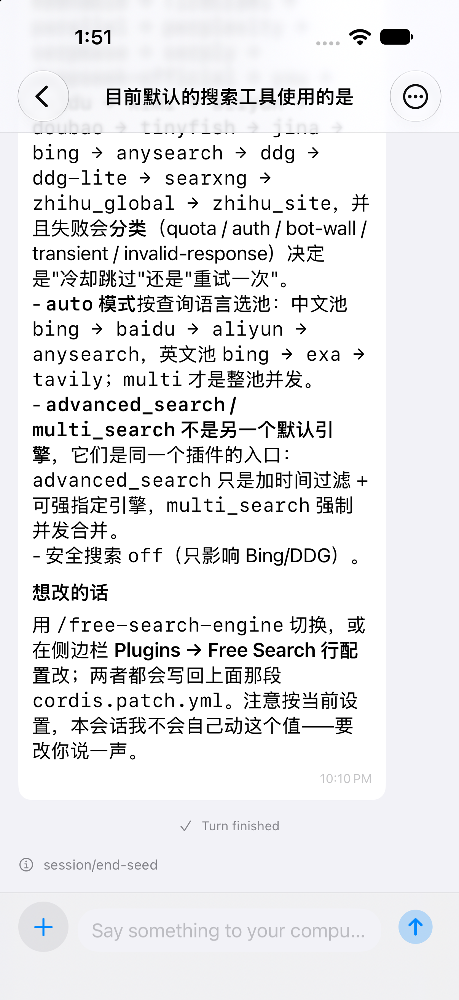
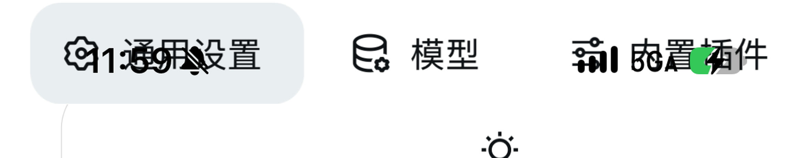
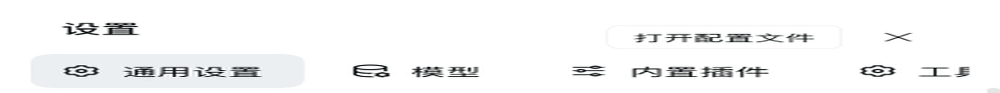

# DSH Pocket

**Your `dsh` sessions, on your iPhone — native, peer-to-peer, no server in the middle.**

DSH Pocket is a native SwiftUI client for [DeepSeek Harness](https://github.com/deepseek-ai/deepseek-harness).
It talks to the `dsh` running on *your own* computer over
[iroh](https://www.iroh.computer/): hole-punched peer-to-peer, so nothing passes through a
third party; when hole-punching fails it falls back to a relay that only ever sees ciphertext.
No port forwarding, no VPN, no account, no server of ours to run.

[中文说明 / Chinese README](README.zh-CN.md)

[](https://github.com/UnsplashZ/dsh-pocket/actions/workflows/ci.yml)
[](https://github.com/UnsplashZ/dsh-pocket/releases)
[](LICENSE)


---

## Status

| | |
|---|---|
| **Version** | v0.3.0 — first public release |
| **Distribution** | **unsigned IPA only.** You re-sign it with your own Apple ID — see [Install](#install-unsigned-ipa). |
| **Host side** | **Untouched.** Uses the upstream `dsh-plugin-tether` as-is; this repo changes zero lines on your computer. |
| **Done & verified** | Session list, timeline, composer, approvals, questions, files/artifacts, settings, pairing — all exercised against a live DSH host |
| **Not done yet** | Real-device pass over the HIG checklist (VoiceOver, dynamic type AX1/AX3/AX5, Increase Contrast), action buttons on approval notifications |

## Screenshots

| Timeline | Settings | Onboarding |
|---|---|---|
|  |  |  |



_Screenshots come from the iOS Simulator. The UI ships bilingual (English + Simplified Chinese)
and follows the system appearance._

---

## Install (unsigned IPA)

Grab `DSHPocket-<version>-unsigned.ipa` from
[Releases](https://github.com/UnsplashZ/dsh-pocket/releases) and re-sign it with your own
Apple ID — a free Apple ID works (the signature lasts 7 days; a paid developer account gives you
a year). [Sideloadly](https://sideloadly.io/) is the simplest route; AltStore/SideStore, Xcode,
or TrollStore also work.

**Full walkthrough, including the 7-day re-sign loop and troubleshooting:
[docs/INSTALL-UNSIGNED-IPA.md](docs/INSTALL-UNSIGNED-IPA.md)** (written in Chinese).

### Why unsigned?

A signed IPA can only be installed on devices authorized by *that* signing account. Shipping a
signed build would either be useless to you, or would mean putting someone else's certificate
into public distribution — which they would be right to revoke, breaking every install at once.
So the release contains the app itself and the signing happens on your machine, with your
identity. Verify your download with the attached checksum:

```bash
shasum -a 256 -c DSHPocket-0.3.0-unsigned.ipa.sha256
```

### Before you install

1. **iOS 17.5 or newer** on the iPhone.
2. **DSH installed and running on your computer**, with the upstream tether plugin:
   ```bash
   dsh plugin install dsh-plugin-tether   # 0.1.20 or newer
   ```
3. Both devices on any network — the same Wi-Fi is fastest, but it works across networks and
   carriers.

---

## Why a native app instead of an embedded web page

The obvious way to get a desktop UI onto a phone is to load that UI in a WebView and inject CSS
to make it fit. That is what the upstream project does — and it **fails on real iOS hardware**,
reproducibly:

| The same HTML (with injection), same 393 pt viewport | Result |
|---|---|
| Chromium / Playwright-WebKit | ✅ renders correctly; hit areas match the labels |
| **iPhone 15 Pro, real-device WebView** | ❌ overlapping navigation text, missing title row, **pixels and tap targets disagree** |

| iPhone (real device) | WebKit on desktop |
|---|---|
|  |  |

The full evidence is in [docs/WHY-NOT-INJECTION.md](docs/WHY-NOT-INJECTION.md).

So DSH Pocket keeps the hard part — the transport — and replaces the part that does not work:

- **Transport: reused as-is.** iroh hole-punching, pairing, relay fallback, cookie injection and
  the local proxy all come from the upstream design; the host-side plugin is used unmodified.
- **UI: rewritten from scratch in SwiftUI.** It consumes DSH's own client protocol directly. No
  injected CSS, no dependency on DSH's DOM, no WebView compositing problems.

---

## How it works

```
┌─ iPhone ────────────────────────────────┐        ┌─ Your computer ─────────────────┐
│  SwiftUI  (DSHPocket)                   │        │                                 │
│      │  DSH client protocol             │        │   dsh  (untouched)              │
│      ▼                                  │        │     ▲                           │
│  DSHKit      unary RPC · /api/remote.mux│        │     │ loopback + cookie          │
│      │       session/follow · $events   │        │     │                           │
│      ▼                                  │        │  dsh-plugin-tether (untouched)  │
│  TetherKit   local TCP proxy 127.0.0.1  │        │     ▲                           │
│      │                                  │        │     │ DLP over iroh QUIC        │
│  IrohLib     iroh endpoint              │◄──────►│  tether sidecar (iroh endpoint) │
└─────────────────────────────────────────┘  iroh  └─────────────────────────────────┘
                                          P2P / relay
```

| Layer | What it is |
|---|---|
| `ios/DSHPocket` | The app: SwiftUI, iOS 17.5+, no third-party UI dependencies |
| `ios/DSHKit` | DSH client protocol: RPC client, WS mux client, `session/follow` projection, timeline builder. Foundation + URLSession only — it knows nothing about iroh or SwiftUI, which is why it unit-tests on macOS |
| `ios/TetherKit` | iroh endpoint + the ~400-line Swift implementation of the DLP wire protocol + a loopback TCP proxy, so the layers above just speak plain HTTP to `127.0.0.1` |
| `ios/vendor` (fetched) | Official [iroh-ffi](https://github.com/n0-computer/iroh-ffi) v1.1.0 prebuilt xcframework + Swift bindings — version and sha256 pinned in `ios/scripts/fetch-iroh.sh`, not committed |
| host | `dsh-plugin-tether`, installed from upstream, unmodified |

Productwise there is exactly **one** connection mode: iroh. It works on the public network, does
not touch a third party when hole-punching succeeds, and only exposes ciphertext when falling
back to the relay — that covers every real scenario, so the app does not expose a "transport"
switch. A **dev-direct gateway** exists for developing the UI in the Simulator without a phone or
pairing; in DEBUG builds it can be enabled through `defaults`
(see `tools/direct-gateway.mjs`).

---

## What it does today

**Session list** — grouped by workspace, pull to refresh, local + host-side search, swipe to
archive, long-press to rename or copy the ID; empty / loading / offline states; connection status
and reconnect.

**Timeline** — turn grouping with collapse animation and auto-stick-to-bottom, user bubbles,
assistant cards (Markdown, tables, copyable code blocks, collapsible reasoning), tool calls folded
to one line (glyph + status + duration, expandable to arguments and output), sub-agent cards,
streaming append, "jump to latest", automatic backfill when you scroll to the top.

**Compaction** — `surfaceOp.replace` is recomputed per range: superseded content collapses into a
"replaced by compaction" section instead of being duplicated.

**Composer** — 1–6 growing rows, one button that turns into send / queue / stop, photo and file
attachments, optimistic insert reconciled by `rpcId`, the `/` command menu (6 host commands + 4
local actions), `@` references (files and sessions), a queue panel you can expand, edit, reorder or
delete from, context-usage bar, per-session stats, live working-state timer.

**Approvals and questions** — approval cards in the timeline plus a local notification; decisions
go out over DSH's native `$events/result`; single-choice, multi-choice and free-text questions.

**Files and artifacts** — workspace browser with system QuickLook; artifact cards with ShareLink.

**Settings** — host management, the computer's default model and reasoning level, providers and
models (**API keys are write-only — the app can store one but never displays it back**), plugin
toggles, scheduled reminders, cache management, archived sessions, notifications, appearance
(theme, font size, raw events, expand reasoning by default), diagnostics, licenses, privacy.

**Pairing** — QR scan (VisionKit), paste the whole pairing string, or type the 6-digit code;
failures are localized per reason code.

**Accessibility and localization** — dynamic type AX1–AX5, VoiceOver labels, dark mode, 44 pt
targets. All **604** user-facing strings are covered in English and Simplified Chinese, and
`ios/scripts/gen-strings.py --check` fails CI if a source literal ever slips out of the catalog
(it scans for Chinese literals in *any* call shape, not just the ones the extractor knows).

---

## Verification

| Scope | Command | Result |
|---|---|---|
| Protocol layer (`DSHKit`) | `cd ios/DSHKit && swift test` | **96 passing** (+20 live tests skipped without a host) |
| Transport layer (`TetherKit`) | `cd ios/TetherKit && swift test` | **33 passing** (port derivation compared bit-for-bit against the Rust implementation, wire-protocol text, pairing-string parsing) |
| App layer | `bash ios/build.sh --test` | **49 tests** |
| Against a **live** DSH host | `DSH_LIVE=1 swift test --filter LiveIntegration` | **20 passing** (unary, `$events`, follow, page, prompt/cancel/selectModel round-trips) |
| Transport interop | `cd ios/spikes/M0BInterop && swift run m0b-interop …` | **passing** — raw output in [docs/artifacts/M0B-EVIDENCE.md](docs/artifacts/M0B-EVIDENCE.md) |

All of the above run in CI on every push and pull request
([`.github/workflows/ci.yml`](.github/workflows/ci.yml)), which also **builds the unsigned IPA** —
so the release path is exercised every time instead of first breaking at tag time.

### Probe the protocol without a phone

```bash
node spikes/m0-probe.mjs unary session/list '{"_request":{}}'   # list sessions, real data
node spikes/m0-probe.mjs events 10                              # open $events (first frame: ready)
node spikes/m0-probe.mjs follow <sessionId> 10                  # session stream (first frame: snapshot)
```

Zero dependencies. Defaults to `127.0.0.1:19387`, override with `DSH_AUTHORITY`. It mints a
session cookie on the fly via [tools/mint-cookie.cjs](tools/mint-cookie.cjs) (reads
`~/.dsh/.credentials.yaml`, **never prints the secret**).

---

## Build from source

### Requirements

| For | You need |
|---|---|
| iOS development | macOS + **Xcode 16 or newer**, an iOS 17.5+ device or simulator |
| Project generation | [xcodegen](https://github.com/yonaskolb/XcodeGen) (`brew install xcodegen`) |
| Protocol probes / tools | **Node ≥ 22** |
| Host | DSH installed, plus `dsh-plugin-tether` **0.1.20+** |

### Simulator

```bash
bash ios/scripts/fetch-iroh.sh   # once: fetch iroh's prebuilt parts (~42 MB, not committed)
bash ios/build.sh                # build
bash ios/build.sh --run          # build, install into a booted simulator, launch
bash ios/build.sh --test         # App-layer unit tests
```

`ios/build.sh` picks an available iPhone simulator automatically — device names change with every
Xcode release, so nothing is hard-coded.

### Real device

```bash
bash ios/build.sh --device       # signed build (needs your team configured)
bash scripts/install-device.sh   # install onto a connected device and launch
```

### Package an unsigned IPA yourself

```bash
bash ios/scripts/make-ipa.sh                       # version taken from ios/VERSION
bash ios/scripts/make-ipa.sh --version 0.3.1 --build 42
# → dist/DSHPocket-0.3.1-unsigned.ipa (+ .sha256, + build log)
```

The script turns code signing off (four settings, not one) and then **asserts** the result: version
and build number inside `Info.plist`, the `Payload/` layout, the presence of the executable, and
that the app really carries no signing identity. A signed artifact is a hard failure — it would
leak the builder's certificate into a public download.

---

## Releasing and version management

**`ios/VERSION` is the single source of truth.** `ios/project.yml` is synced from it; nothing else
should be edited by hand.

```bash
bash ios/scripts/version.sh get              # 0.3.0
bash ios/scripts/version.sh tag              # v0.3.0
bash ios/scripts/version.sh set 0.4.0 12     # set version + build number, sync project.yml
bash ios/scripts/version.sh bump minor       # 0.3.0 → 0.4.0
bash ios/scripts/version.sh check v0.4.0     # assert consistency (used by CI)
```

The build number (`CURRENT_PROJECT_VERSION`) is deliberately *not* part of the version: the same
version gets built many times. Locally it keeps whatever `project.yml` says; CI overrides it with
`github.run_number`.

### Workflows

| Workflow | Trigger | Does |
|---|---|---|
| [`ci.yml`](.github/workflows/ci.yml) | push to `main`, PR, manual | Localization + version-drift checks · library unit tests · App unit tests · unsigned IPA as an artifact |
| [`release.yml`](.github/workflows/release.yml) | tag `v*`, or manual | The only release path. Verifies the tag against `ios/VERSION`, builds the unsigned IPA, and publishes the GitHub Release with the IPA, its `.sha256`, and release notes taken from `CHANGELOG.md`. A manual run can also bump the version (`bump`/`version` inputs) and commit it for you. |

> Version bumping lives **inside** `release.yml` on purpose: a tag pushed with the repository's
> own `GITHUB_TOKEN` does **not** trigger another workflow (GitHub's recursion guard). Split into
> two workflows, the bump would push a tag and then silently release nothing. Kept in one run, the
> tag is just a label and the subsequent steps happen in the same run — no PAT, no
> `workflow_dispatch` workaround.

### Cutting a release

1. Move the `Unreleased` entries in [CHANGELOG.md](CHANGELOG.md) into a new `## [X.Y.Z]` section
   and merge it. The workflow refuses to release a version that has no changelog section.
2. Actions → **release** → Run workflow → pick `patch` / `minor` / `major`
   (or type an explicit `version`). It bumps `ios/VERSION`, syncs `project.yml`, commits, tags,
   builds, and publishes.
3. Or do it by hand: `bash ios/scripts/version.sh bump minor`, commit, `git tag v0.4.0`,
   `git push origin v0.4.0` — the tag push runs the same pipeline.

---

## Repository layout

```
dsh-pocket/
  README.md · README.zh-CN.md · CHANGELOG.md · LICENSE · NOTICE.md
  .github/workflows/       ci · release
  docs/                    design notes and evidence (mostly Chinese)
  ios/
    VERSION                ← the single source of truth for the version
    project.yml            xcodegen project definition (App + 3 in-project frameworks)
    build.sh               one command to build / test / run
    DSHPocket/             the app
    DSHPocketTests/        app-layer unit tests (49)
    DSHKit/                SwiftPM: DSH client protocol (116 tests)
    TetherKit/             SwiftPM: iroh wrapper + DLP + local proxy (33 tests)
    scripts/               fetch-iroh.sh · make-ipa.sh · version.sh · select-xcode.sh · pick-simulator.sh
    spikes/M0BInterop/     transport interop verification
    vendor/                iroh parts (not committed, fetched by script)
  tools/                   host-side helpers (cookie minting, dev gateway, capture, status)
  spikes/m0-probe.mjs      zero-dependency protocol probe
  scripts/                 changelog-section.mjs · install-device.sh
```

### Docs map

The deep design notes are currently **Chinese only**; translations on request.

| Document | Read it when |
|---|---|
| [docs/DESIGN.md](docs/DESIGN.md) | The main plan: architecture, reuse/replace boundary, protocol design, milestones |
| [docs/IOS-DESIGN.md](docs/IOS-DESIGN.md) | Before touching UI: navigation, per-screen specs, design tokens, accessibility |
| [docs/TRANSPORT.md](docs/TRANSPORT.md) | Before touching transport: iroh Swift API, DLP wire protocol, local proxy, Info.plist |
| [docs/PROTOCOL-NOTES.md](docs/PROTOCOL-NOTES.md) | DSH client protocol facts: auth, endpoint catalog, three event channels, 27 gotchas |
| [docs/WHY-NOT-INJECTION.md](docs/WHY-NOT-INJECTION.md) | Why the UI layer was not reused from upstream |
| [docs/DECISIONS.md](docs/DECISIONS.md) | Before changing a design: 12 ADRs and their consequences |
| [docs/ROADMAP.md](docs/ROADMAP.md) | Tickable milestone tasks and acceptance criteria |
| [docs/INSTALL-UNSIGNED-IPA.md](docs/INSTALL-UNSIGNED-IPA.md) | Installing and re-signing |
| [docs/artifacts/M0B-EVIDENCE.md](docs/artifacts/M0B-EVIDENCE.md) | Raw transport-interop output and how to reproduce it |

---

## Security model

Stated plainly, including what it does **not** protect you from.

1. End-to-end encryption comes from iroh. A successful hole-punch means no third party is involved
   at all; the relay fallback only ever sees ciphertext.
2. Pairing codes are 6 digits, valid for 10 minutes, 3 attempts. After pairing, access is decided
   by the phone's public key.
3. **Host-side known limit:** anyone who can already run code on your computer can mint a pairing
   code for themselves and register as a "phone".
4. **Phone-side known limit:** the app's local proxy only listens on `127.0.0.1`, but other apps on
   the phone can reach it, and the port is derivable from the host ID.

Details in [docs/TRANSPORT.md](docs/TRANSPORT.md) §8.
**Do not use this app on a computer where you also run untrusted code.**

---

## Credits and license

MIT — see [LICENSE](LICENSE). Third-party attributions, including the upstream notice this project
is required to carry, are in [NOTICE.md](NOTICE.md).

| Project | What we take from it |
|---|---|
| [zexadev/dsh-tether](https://github.com/zexadev/dsh-tether) | **The parent project.** The host side is reused as-is; the DLP wire protocol and port derivation are treated as a contract; the real-device Info.plist conclusions come from there. The UI layer is not reused. |
| [n0-computer/iroh-ffi](https://github.com/n0-computer/iroh-ffi) | Official Swift bindings (v1.1.0, prebuilt xcframework) |
| [jayantTang/DSH_Mobile](https://github.com/jayantTang/DSH_Mobile) | Protocol documentation and endpoint catalog as a fact-checking source (**no code copied**, per ADR-0005) |
| [deepseek-ai/deepseek-harness](https://github.com/deepseek-ai/deepseek-harness) | Upstream; consumed purely as a protocol, never modified |

DSH Pocket is an independent community project. It is not affiliated with DeepSeek or with the
authors of the projects above.

---

## Notes for contributors in sandboxed environments

Building inside a restricted sandbox (container, CI, an agent session) needs
`DSH_POCKET_SWIFT_FLAGS="-disable-sandbox"`: the Swift compiler's macro plugin host cannot nest
another `sandbox-exec`, and the failure surfaces as a wall of unrelated
`cannot find '$xxx' in scope` errors. `ios/build.sh` passes the variable through; for `swift test`
in the same situation, add `--disable-sandbox`. Also note that `xcodegen` globs source files only
when it generates — after adding a `.swift` file, re-run `bash ios/build.sh`.
