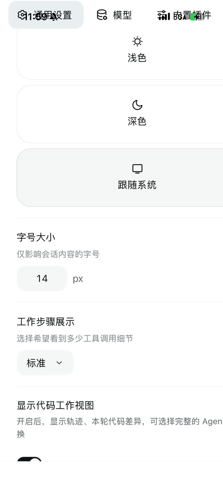

# 为什么放弃"注入 CSS 适配手机"这条路线

> 2026-10-12 · 基于 DSH `0.2.0-rc.2` + `dsh-plugin-tether@0.1.20` 的本机复现与 iPhone 15 Pro 真机实测

## 结论

tether 的传输层（iroh 打洞 / 配对 / 中转 / cookie 注入）**是好的、可以复用**；
它的**界面适配层**（把 DSH 桌面网页交给手机 WebView，再注入 CSS/JS 掰成竖屏）**在真机上已经实测失败**，而且是一条修不合算的负债。

---

## 1. 硬证据：同一份产物，三个渲染器，只有真机坏

对照条件完全一致：**同一台主机、同一份 HTML（含注入的 `<style>` 与 `<script>`）、同一视口宽 393 CSS px**。

| 渲染器 | 结果 |
|---|---|
| Chromium 393×852（Playwright） | ✅ 设置弹窗导航 8 项横向均匀排开，各 40px 高，点击区与标签一一对应 |
| WebKit 393×852 + iPhone UA + touch（Playwright） | ✅ 同上，**完全正确** |
| **iPhone 15 Pro 真机 WebView** | ❌ 标签叠印、「设置」标题行消失、选中胶囊高了一倍多 |

**真机（设置 → 通用设置）**


**同一份 HTML 在 Playwright WebKit（393×852）**


**真机整屏**



### 复现方法（可重做）

```bash
# 1) 从本机 DSH 取到"手机看到的那份 HTML"（含注入）
node tools/mint-cookie.cjs 127.0.0.1:19387            # 输出 Cookie 头
curl -s -H "Cookie: <上面的输出>" http://127.0.0.1:19387/ -o index.html

# 2) 在桌面浏览器里以手机视口打开，点开「设置」
#    （Chromium / WebKit 都会渲染正常，这就是对照）

# 3) 真机截图（不需要越狱、不需要 Web Inspector）
xcrun devicectl device capture screenshot --device <UDID> --destination phone.png
```

> `mint-cookie.cjs` 用 `~/.dsh/.credentials.yaml` 里 `client-connection/browser-session` 的 32 字节密钥按 DSH 的 `v1.<payload>.<hmac>` 格式现签一个 cookie。纯本机、不打印密钥。

---

## 2. 失败模式逐条拆解

### 2.1 直接原因（触发本次故障）

DSH 原生 CSS 里，设置弹窗的导航是一个**竖向滚动容器**：

```css
.Dws9Sa_navList { flex-direction: column; gap: 4px; display: flex; overflow-y: auto }
```

tether 的注入在 `≤640px` 下把它改成横向：

```css
navList { flex-direction: row !important; overflow-x: auto !important; height: auto !important; gap: 6px }
```

**它翻了轴、加了 `overflow-x`，但没有复位原来的 `overflow-y`** —— 于是这个元素变成"flex 行 + 双轴 `auto`"的滚动容器。

- Chromium / Playwright-WebKit：按新布局正确渲染；
- 真机 iOS WebView：出现叠字与旧帧残留，而**点击的命中区域是按新布局计算的** → 用户看到的是 A，点下去命中的是 B。

> **机制部分是推断**：我们无法在该设备上开 Web Inspector（release 构建），所以没取到手机内活的 DOM/计算样式。可确定的是"同一份产物在三个渲染器上结果不同"这一事实。

### 2.2 结构性原因：用"隐式状态位"推断布局

注入脚本判断"抽屉是否展开"的方式是：

```js
var handle = frame.querySelector(':scope > [class*="_handle"]')   // 拖拽把手是否存在 == 抽屉展开？
if (!handle) return
// …然后：吃掉这一次 pointerdown，并替用户点一次侧栏开关
event.preventDefault(); event.stopPropagation(); toggle.click()
```

问题有三层：

1. **`[class*="_handle"]` 是子串匹配**，任何插件把类名里含 `_handle` 的元素放到 `_frame` 下都会被误判（本机装的 `dsh-better-sidebar` 客户端里 `_handle` 出现 8 次、`grid-template` 7 次，它正是一个大改侧栏 DOM 的插件）；
2. 一旦误判为"展开"，**每一次点在侧栏外的触摸都会被 `preventDefault + stopPropagation` 吃掉**，只换来一次侧栏开关的抖动；
3. 状态位不是状态：把手"存在"≠"抽屉可见"，二者只在 DSH 当前实现下恰好等价。

### 2.3 结构锚点全是哈希类名

注入选择器主要靠：`[class*="_frame"]`、`[class*="sidebarCol"]`、`[class*="centerCol"]`、`[class*="navList"]`、`[class*="navCell"]`、`[class*="footArea"]`、`[class*="footerActions"]`、`[class*="rowText"]`。

上游每次改样式/改类名（甚至 CSS Modules 的内容哈希变化导致同一语义改名），这些规则就静默失效或错配 —— 失效是"退回现状"，错配则是"更糟"。注入注释里已经能看到为 `dsh-cost-meter` 打补丁的痕迹，说明这类冲突是常态而非偶发。

### 2.4 断点单一、信息密度不适配

只有一个 `@media (max-width: 640px)` 开关。而 DSH 的界面是为桌面设计的：正文明文宽度、侧栏 56px 图标条、详情列、工具调用全量展开。手机屏 393px 下即便"渲染正确"，信息密度与交互目标也不是移动端该有的样子 —— 修好渲染也只是"能看能点"，不是好用。

### 2.5 盲调试：这条路在手机上不可观测

- release 构建的 WebView 没有可用的 Web Inspector；
- 这台设备的 `devicectl device capture screen-record` 报 `Capability "Screen Recording" is not supported by this device`，只能抓静态截图；
- 上游插件作者在 [issue #6](https://github.com/zexadev/dsh-tether/issues/6) 里明确说过自己没有苹果硬件，IPA 只在 CI 构建、"从未在真机跑过"。

于是任何真机问题都变成"用户描述 → 猜 → 改 → 用户再试"的循环，一次迭代以天计。

---

## 3. 为什么"就地修一下"不划算

即便我们立刻把 §2.1 那一行补成 `overflow-y: hidden`（很可能是有效的一行修复），仍然保留：

- §2.2 的状态位误判风险（随时被任意第三方插件触发）；
- §2.3 的类名脆弱性（每次 DSH 升级都要重新对表）；
- §2.4 的体验天花板（修好也只是勉强能用）；
- §2.5 的盲调试成本。

**投入产出比在"重写界面"这一侧。** 而且重写的那部分恰好是**唯一可以完全自控、不随上游 DOM 变动**的部分：协议是契约（有文档、可自检），DOM 是巧合。

---

## 4. 因此的取舍

| 保留（已验证可用、与界面无关） | 替换（脆弱、且是体验瓶颈） |
|---|---|
| iroh P2P 打洞 + 中转回退 | 代理 DSH 桌面 `index.html` |
| 6 位配对码 + 设备公钥白名单 | 16 KB 注入 CSS/JS |
| DLP v1 帧协议 | 用 `_handle` 推断抽屉状态 |
| 电脑侧 cookie 兑换与逐请求注入 | 单一 640px 断点 |
| 手机侧 TCP 代理与端口派生（保证 cookie authority 稳定） | 在 WebView 里盲调 DSH 的 DOM |
| 多主机管理、语言、本地模式 | |

详见 [DESIGN.md](DESIGN.md) §3.2。
